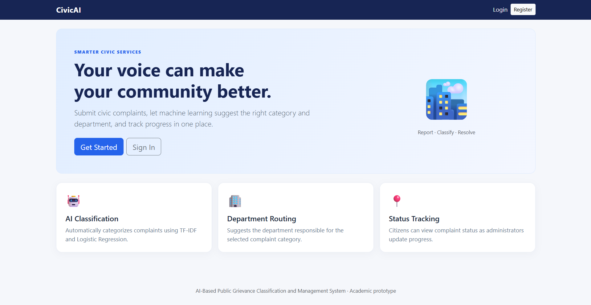
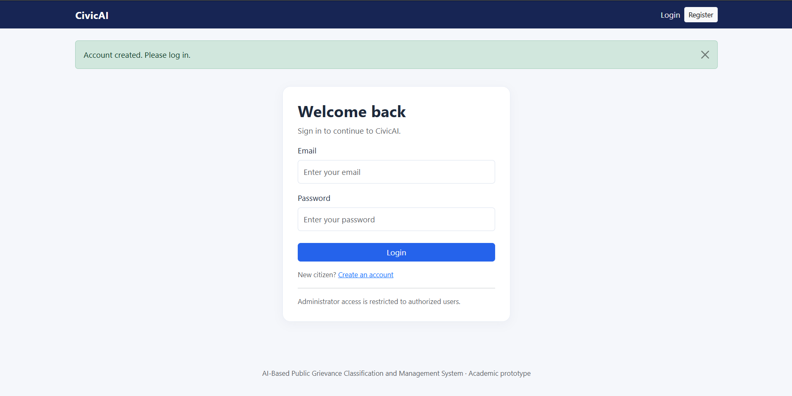
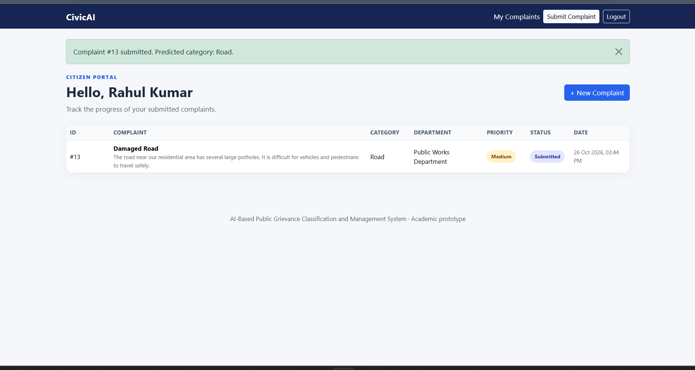
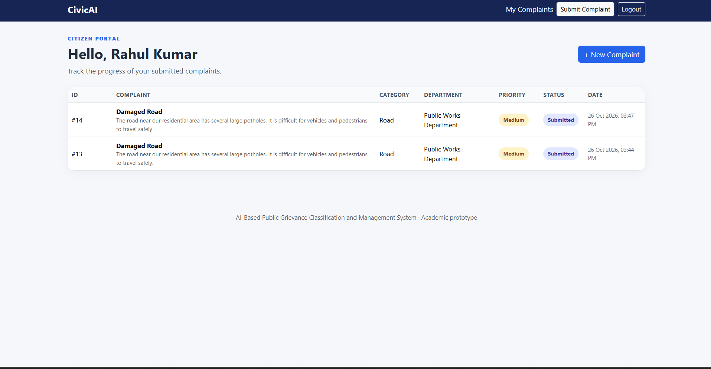
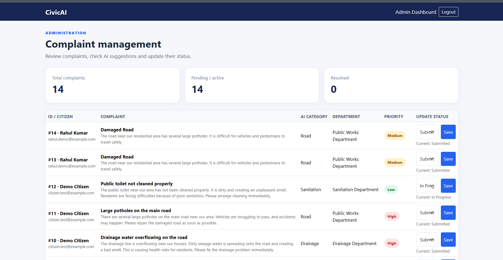

# AI-Based Public Grievance Classification and Management System

<p align="center">

**An intelligent platform for submitting, classifying, and managing public grievances using Machine Learning.**

</p>

<p align="center">
  Python · Flask · Machine Learning · Scikit-learn · SQLite · HTML · CSS · Bootstrap
</p>

---

## About the Project

The **AI-Based Public Grievance Classification and Management System** is a web-based application designed to simplify public complaint management.

The system allows citizens to register, log in, submit complaints, and track their complaint status. It uses Machine Learning techniques to automatically classify complaints into appropriate categories and map them to the relevant government departments.

Administrators can access a dedicated dashboard to view complaints, monitor submissions, and update complaint statuses.

## Objectives

- Make public grievance submission easier for citizens.
- Automatically classify complaints using Machine Learning.
- Map complaints to the appropriate government departments.
- Provide a centralized platform for complaint management.
- Allow citizens to track complaint progress.
- Improve transparency and organization in grievance handling.

## Key Features

### Citizen Module

- Citizen registration and secure login.
- Submit public complaints through a web interface.
- Automatic Machine Learning-based complaint classification.
- View previously submitted complaints.
- Track complaint status.

### Administrator Module

- Administrator login.
- View and manage submitted complaints.
- View automatically predicted complaint categories.
- Identify the responsible department.
- Update complaint status.
- Monitor grievance records through an admin dashboard.

### Machine Learning Module

- Text preprocessing and feature extraction using TF-IDF.
- Complaint classification using Logistic Regression.
- Six complaint categories.
- Automatic department mapping based on predicted category.

## Complaint Categories and Department Mapping

| Complaint Category | Assigned Department |
|---|---|
| Road | Public Works Department |
| Water | Water Supply Department |
| Garbage | Waste Management Department |
| Drainage | Drainage Department |
| Electricity | Electricity Department |
| Sanitation | Sanitation Department |

## Technology Stack

| Technology | Purpose |
|---|---|
| Python | Backend programming |
| Flask | Web application framework |
| Scikit-learn | Machine Learning |
| TF-IDF | Text feature extraction |
| Logistic Regression | Complaint classification |
| SQLite | Database management |
| HTML | Web page structure |
| CSS | Styling |
| Bootstrap | Responsive user interface |
| Joblib | Saving and loading ML models |

## System Workflow

1. A citizen registers or logs into the application.
2. The citizen submits a public complaint.
3. The complaint text is processed using the TF-IDF vectorizer.
4. The trained Logistic Regression model predicts the complaint category.
5. The system maps the category to the appropriate department.
6. The complaint details are stored in the SQLite database.
7. The administrator views and manages the complaint.
8. The citizen can track the updated complaint status.

## Machine Learning Model

The system uses a supervised Machine Learning approach.

**TF-IDF (Term Frequency–Inverse Document Frequency):** Converts complaint text into numerical features that represent the importance of words.

**Logistic Regression:** Uses the extracted features to predict one of the six complaint categories.

**Model Evaluation:** The current model achieved 84.21% accuracy on a held-out test split of a small synthetic demonstration dataset.

> Note: This accuracy is based on synthetic sample data and should not be interpreted as real-world performance. Further testing with larger, real-world datasets is required.

## Project Structure

```text
PublicGrievanceSystem/
│
├── app.py
├── train_model.py
├── requirements.txt
├── README.md
├── .gitignore
│
├── dataset/
│   ├── complaints.csv
│   └── .gitignore
│
├── models/
│   ├── grievance_model.pkl
│   └── tfidf_vectorizer.pkl
│
├── static/
│   └── css/
│       └── style.css
│
└── templates/
    ├── base.html
    ├── index.html
    ├── login.html
    ├── register.html
    ├── submit.html
    ├── dashboard.html
    └── admin.html
```

## Installation and Setup

Follow these instructions to run the project on Windows.

### Prerequisites

- Python 3.13
- Git
- Visual Studio Code (recommended)

### Step 1: Clone the Repository

```bash
git clone https://github.com/akshay2005-15/AI-Public-Grievance-Management-System.git
```

### Step 2: Open the Project Folder

```bash
cd AI-Public-Grievance-Management-System
```

### Step 3: Create a Virtual Environment

```bash
py -3.13 -m venv venv
```

### Step 4: Activate the Virtual Environment

For Windows PowerShell:

```powershell
.\venv\Scripts\Activate.ps1
```

### Step 5: Install Required Packages

```bash
python -m pip install -r requirements.txt
```

### Step 6: Configure Environment Variables

Create a file named `.env` in the project root directory.

Add the following configuration:

```env
SECRET_KEY=replace_with_a_random_secret_key
ADMIN_EMAIL=admin@grievance.local
ADMIN_PASSWORD=ChooseYourOwnStrongPassword
```

Generate a random secret key using:

```powershell
python -c "import secrets; print(secrets.token_hex(32))"
```

Replace the example secret key with the generated value. Choose your own strong administrator password.

**Important:** Never upload your `.env` file or share your secret key and administrator password publicly.

### Step 7: Run the Application

```bash
python app.py
```

Open your browser and visit:

```text
http://127.0.0.1:5000
```

The application should now be running locally.

## Screenshots

Add screenshots of your actual application in the `screenshots/` folder.

Suggested screenshots:

| Screenshot | Suggested filename |
|---|---|
| Home page | home.png |
| Citizen registration | register.png |
| Citizen login | login.png |
| Complaint submission | submit-complaint.png |
| Citizen dashboard | citizen-dashboard.png |
| Administrator dashboard | admin-dashboard.png |

Once you add these images, display them here:

### Home Page



### Citizen Registration



### Complaint Submission



### Citizen Dashboard



### Administrator Dashboard



*These are image placeholders. Add your actual application screenshots using the filenames above.*

## Future Enhancements

- Improve classification using larger real-world datasets.
- Support multiple regional languages.
- Add email and SMS notifications.
- Integrate location-based complaint tracking.
- Generate complaint analytics and reports.
- Deploy the application to a cloud hosting platform.

## Project Limitations

- The current Machine Learning model uses a small synthetic dataset.
- Classification accuracy may vary with real-world complaints.
- The current application is intended as an academic demonstration and requires additional security and scalability improvements before production use.

## Author

**Akshay**

GitHub: [akshay2005-15](https://github.com/akshay2005-15)

## Repository

[AI-Based Public Grievance Classification and Management System](https://github.com/akshay2005-15/AI-Public-Grievance-Management-System)

---

<p align="center">
  **Developed as an Engineering Academic Project**
</p>
